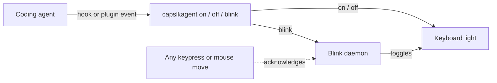

<div align="center">

# capslkagent

Your Caps Lock LED as a status light for coding agents.

[](https://github.com/jagenaujagenau/capslkagent/blob/main/LICENSE)
[](https://github.com/jagenaujagenau/capslkagent/releases)
[](https://github.com/jagenaujagenau/capslkagent/actions)
[](https://github.com/jagenaujagenau/capslkagent/stargazers)

</div>

## What is this?

capslkagent turns a light on your keyboard into a status light for Claude Code,
Codex, pi, oh-my-pi (omp), Amp or opencode. Glance down to see whether the
agent is working, waiting on you, or done.

| Light | Meaning |
|-------|---------|
| Solid on | Agent is working |
| Blinking | Agent needs your attention (permission prompt, question) |
| Off | Agent is idle |

It runs on macOS, Linux and Windows as one small Rust binary (~400 KB) with no
runtime dependencies beyond the OS. On Mac laptops it can drive the **keyboard
backlight** instead (`--backlight`): bright while the agent works, flashing
when it needs you, and back to your own brightness when it's idle.

## Quick Start

```sh
brew install jagenaujagenau/tap/capslkagent   # or grab a binary from Releases
capslkagent install-hooks --agent all          # wire up every agent on this machine
```

Then restart your agent. To build from source instead:

```sh
cargo build --release
cp target/release/capslkagent ~/.local/bin/
```

## Supported agents

```sh
capslkagent install-hooks                      # Claude Code (default)
capslkagent install-hooks --agent codex        # or: pi, omp, amp, opencode
capslkagent install-hooks --agent all          # every agent set up on this machine
capslkagent --backlight install-hooks          # keyboard backlight instead (macOS)
capslkagent uninstall-hooks --agent all        # remove everything again
```

`install-hooks` points the agent at the binary's absolute path, so re-run it
if you move the binary. Running it again is safe: it replaces its own entries.

| Agent | What gets installed | On | Blink | Off |
|-------|---------------------|----|-------|-----|
| Claude Code | hooks in `~/.claude/settings.json` | `UserPromptSubmit` | `Notification` | `Stop`, `SessionEnd` |
| Codex | hooks in `~/.codex/hooks.json` | `UserPromptSubmit` | `PermissionRequest` | `Stop`, `Interrupt`, `SessionEnd` |
| pi | extension `~/.pi/agent/extensions/capslkagent.ts` | `agent_start` | extension dialogs (`ui_prompt_start`) | `agent_settled`, `session_shutdown` |
| omp | extension `~/.omp/agent/extensions/capslkagent.ts` | `agent_start` | `tool_approval_requested` | `agent_end`, `session_shutdown` |
| Amp | plugin `~/.config/amp/plugins/capslkagent.ts` | `agent.start` | thread state `awaiting-approval` | `agent.end`, shutdown |
| opencode | plugin `~/.config/opencode/plugins/capslkagent.js` | `session.status` busy | `permission.asked`, `question.asked` | `session.status` idle |

- **Claude Code and Codex** run shell hooks. Your existing hooks are kept;
  only capslkagent's own entries are added or replaced. `CLAUDE_CONFIG_DIR`
  and `CODEX_HOME` are honoured. **Codex asks you to trust new hooks**: run
  `/hooks` in Codex once after installing.
- **pi, omp, Amp and opencode** load JS/TS plugins, so capslkagent writes one
  small managed file that runs the binary. It never overwrites or deletes a
  file it didn't write. `PI_CODING_AGENT_DIR` and `XDG_CONFIG_HOME` are
  honoured.
- Subagents (opencode task sessions, omp subagents) don't drive the light.
- pi has no built-in permission prompts, so it only blinks for extension
  dialogs.

## How it works



Each agent event runs `capslkagent on`, `off` or `blink`. `blink` starts a
small detached daemon; the next `on`/`off` stops it.

**Blinking stops as soon as you touch the keyboard or mouse.** The light then
returns to its state from before the blink, e.g. solid on if the agent keeps
working after you approve a permission prompt. This uses the system's HID idle
timer, so no accessibility permission is needed. It works on macOS and
Windows. Linux has no permission-free system-wide idle source, so there the
blink stops on the agent's next event instead.

### Manual usage

```sh
capslkagent on          # solid light
capslkagent blink       # flash (default 0.4s); `blink 0.2` for faster
capslkagent off         # light off (also stops blinking)
capslkagent toggle
capslkagent status      # print on/off/blinking (doesn't stop a blink)
```

All commands accept `--target capslock|backlight` (or the `--backlight`
shorthand); caps lock is the default.

### Per platform

- **macOS (caps lock)**: calls IOKit's
  `IOHIDSetModifierLockState(kIOHIDCapsLockState)` directly via FFI.
- **macOS (backlight)**: talks to `KeyboardBrightnessClient` in the private
  `CoreBrightness.framework` via `dlopen` and the Objective-C runtime, so
  nothing private is linked at build time. `on` saves your brightness and goes
  to full; `off` restores it. Being a private framework, this could break in a
  future macOS release (works on macOS 26). The system's automatic backlight
  dimming may still adjust brightness on top.
- **Linux**: writes `/sys/class/leds/*capslock*/brightness`, which drives the
  LED *without* changing typing state. Falls back to `xset led` under X11.
- **Windows**: synthesizes a `VK_CAPITAL` key press via `user32.keybd_event`.

> [!WARNING]
> **Caps lock is caps lock.** On macOS and Windows the LED is tied to the real
> caps-lock state, so while the light is on, **typing produces CAPITALS**. On
> Linux the sysfs backend changes only the LED. On a Mac laptop,
> `--backlight` avoids this entirely.

### Linux permissions

`/sys/class/leds/.../brightness` is root-writable by default. Grant your user
access with a udev rule:

```sh
sudo tee /etc/udev/rules.d/99-capslock-led.rules <<'EOF'
ACTION=="add", SUBSYSTEM=="leds", KERNEL=="*capslock*", RUN+="/bin/chmod 0666 /sys%p/brightness"
EOF
sudo udevadm control --reload && sudo udevadm trigger -s leds
```

## Building for other platforms

Each backend uses platform-native FFI behind `#[cfg]` gates, so binaries are
built on the target OS rather than cross-compiled. Pushing a `vX.Y.Z` tag runs
`.github/workflows/release.yml`, which builds every target and attaches the
archives to a GitHub Release:

| Target | Runner | Rust target |
|--------|--------|-------------|
| macOS universal (arm64 + x86_64) | `macos-latest` | both, merged with `lipo` |
| Linux x86_64 | `ubuntu-latest` | `x86_64-unknown-linux-gnu` |
| Linux aarch64 | `ubuntu-24.04-arm` | `aarch64-unknown-linux-gnu` |
| Windows x86_64 | `windows-latest` | `x86_64-pc-windows-msvc` |

Locally you can only cross-compile to the host OS's own architectures (e.g. a
macOS universal binary) without extra toolchains such as `cross` or mingw.

## Project Structure

```
capslkagent/
├── .github/
│   └── workflows/
│       ├── ci.yml          # clippy + tests on macOS, Linux, Windows
│       └── release.yml     # builds and publishes release binaries
├── src/
│   ├── plugins/            # JS templates for pi/omp, Amp, opencode
│   │   ├── amp.js
│   │   ├── common.js
│   │   ├── opencode.js
│   │   └── pi.js
│   ├── agents.rs           # per-agent install/uninstall
│   ├── daemon.rs           # blink daemon
│   ├── hooks.rs            # Claude-style hooks JSON editing
│   ├── led.rs              # caps lock / backlight backends
│   └── main.rs             # CLI
├── CHANGELOG.md
├── Cargo.lock
├── Cargo.toml
├── LICENSE
└── README.md
```

## Documentation

| Resource | Description |
|----------|-------------|
| [CHANGELOG.md](CHANGELOG.md) | Release notes for every version |
| [Releases](https://github.com/jagenaujagenau/capslkagent/releases) | Prebuilt binaries for macOS, Linux and Windows |
| [release.yml](.github/workflows/release.yml) | How release binaries are built |

## Contributing

Issues and pull requests are welcome. Run `cargo test` before opening a PR;
CI also runs `cargo clippy --all-targets -- -D warnings` on all three OSes.

<a href="https://github.com/jagenaujagenau/capslkagent/graphs/contributors">
  
</a>

## License

[MIT](LICENSE)

---

<div align="center">

[](https://star-history.com/#jagenaujagenau/capslkagent&Date)

</div>
